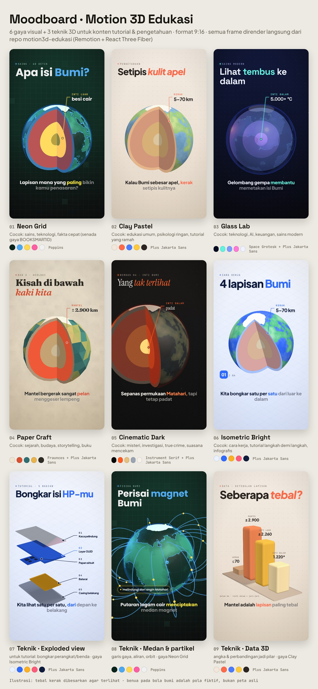

# Motion3D Edukasi

Kit video **3D vertikal (9:16)** untuk konten **tutorial & pengetahuan**: model 3D, belahan penampang (*cross-section*), label penunjuk yang menempel ke objek, gelombang & garis medan, data 3D, dan *exploded view*. Semuanya dibuat dari kode lalu dirender jadi MP4, tanpa AI video generator.

Dibangun di atas [Remotion](https://www.remotion.dev) + [React Three Fiber](https://r3f.docs.pmnd.rs) (Three.js).



## Isi kit

| Komposisi | Untuk apa | Durasi |
|---|---|---|
| `LapisanBumi` | Contoh video pengetahuan **"Apa isi Bumi?"**: bumi dibelah, 4 lapisan, gelombang gempa, medan magnet, subtitle karaoke, SFX halus | ±90 dtk |
| `TutorialLangkah` | Template tutorial langkah demi langkah (*exploded view* HP). Judul & isi langkah diganti dari panel, tanpa koding | ±26 dtk |
| `ContohModel` | Contoh memakai **model .glb sendiri** (molekul air) | 10 dtk |
| `GayaFrame` | Satu frame contoh per gaya (untuk thumbnail/referensi) | gambar |
| `Moodboard` | Moodboard 6 gaya + 3 teknik (gambar di atas) | gambar |

## 6 gaya visual

Ganti `tema` di panel kanan Remotion Studio. Satu kata, seluruh video ikut berubah.

| `tema` | Nama | Cocok untuk |
|---|---|---|
| `neon` | Neon Grid | sains, teknologi, fakta cepat (senada gaya BOOKSMARTID) |
| `clay` | Clay Pastel | edukasi umum, psikologi ringan, tutorial ramah |
| `glass` | Glass Lab | teknologi, AI, keuangan, sains modern |
| `paper` | Paper Craft | sejarah, budaya, storytelling |
| `cinema` | Cinematic Dark | misteri, investigasi, suasana mencekam |
| `iso` | Isometric Bright | cara kerja, tutorial langkah demi langkah, infografis |

Mau gaya sendiri (warna brand)? Salin salah satu blok di `src/themes.ts`, ganti warnanya.

## Mulai di laptop Windows (sekali saja)

1. Pasang **Node.js 22 LTS** dari [nodejs.org](https://nodejs.org).
2. Ekstrak zip ini, buka foldernya, klik kanan, lalu pilih **Open in Terminal**.
3. Jalankan:
   ```
   npm install
   npm run dev
   ```
4. Browser membuka **Remotion Studio** (http://localhost:3000). Pilih `LapisanBumi`, tekan spasi untuk memutar.

## Render ke MP4

| Perintah | Hasil |
|---|---|
| `npm run render` | `out/lapisan-bumi_9x16_v1.mp4` (1080×1920, 30 fps) |
| `npm run render:preview` | versi setengah resolusi, lebih cepat untuk cek |
| `npm run render:tutorial` | `out/tutorial_9x16_v1.mp4` |
| `npm run moodboard` | `out/moodboard.png` |

Cara paling gampang untuk render dengan gaya lain: di Studio, ganti `tema`, lalu klik tombol **Render** di kanan atas.

## Pakai suara sendiri (ElevenLabs / Speechma)

1. Naskah lengkap ada di `docs/naskah-lapisan-bumi.md`. Tag seperti `[warm, inviting]` adalah arahan ekspresi untuk TTS.
2. Simpan hasil TTS sebagai `public/audio/narasi.mp3`.
3. Durasi video otomatis menyesuaikan panjang audio.
4. Supaya gambar pas dengan suara, geser angka waktu di **`timeline.json`** (adegan, subtitle, SFX ada di satu file). Cara cepat: centang `skalaKeAudio` di panel kanan agar semua adegan diregangkan rata.

## Bikin video baru dengan Claude

Buka folder ini di Claude Code, lalu minta misalnya:

> Baca CLAUDE.md. Buat video 3D 60–90 detik "Bagaimana pesawat bisa terbang", gaya `iso`, ikuti pola LapisanBumi: naskah dulu, lalu timeline.json, lalu adegan. Kirim contact sheet frame sebelum render.

Opsional: pasang skill resmi Remotion agar Claude makin paham Remotion: `npx remotion skills add`.

## Pakai model 3D sendiri (.glb)

1. Cari model gratis:
   - **CC0** (bebas tanpa kredit): Poly Pizza, Kenney, Quaternius.
   - **NASA 3D Resources**: planet, satelit, wahana.
   - **Sketchfab**: cek lisensi tiap model. Banyak yang CC-BY, jadi tulis kredit di caption.
2. Taruh file di `public/models/`, misalnya `public/models/roket.glb`.
3. Di dalam `<Stage>`, tulis `<Model src="models/roket.glb" fit={2} />`. Contoh lengkapnya ada di `src/compositions/ContohModel.tsx`.

Model yang punya animasi bawaan (rig) belum otomatis bergerak mengikuti frame. Minta Claude menambahkan `AnimationMixer` yang di-*set* per frame (`mixer.setTime(t)`).

## Peta Bumi asli (opsional)

Benua di bola Bumi saat ini adalah pola buatan (fiktif). Untuk peta asli, simpan gambar peta *equirectangular* (misalnya NASA Blue Marble, domain publik) sebagai `public/textures/bumi.jpg`, lalu isi `peta` dengan `textures/bumi.jpg` di panel kanan.

## Struktur folder

```
timeline.json        semua waktu: adegan, subtitle, SFX (edit di sini)
src/themes.ts        6 gaya: warna, font, material, cahaya
src/compositions/    video: LapisanBumi, TutorialLangkah, ContohModel, Moodboard, StyleFrame
src/three/           objek 3D: Earth (bisa dibelah), Phone (exploded), Pillars, FieldLines, Model (.glb)
src/components/      teks & subtitle, label penunjuk, penggaris kedalaman, ikon, latar
public/              font, SFX, tekstur, model, audio narasi
scripts/             pembuat SFX/tekstur/model contoh, pembuat contact sheet
docs/                naskah, sumber fakta, referensi repo lain
```

## Cek cepat sebelum render penuh

```
node scripts/contact-sheet.mjs . LapisanBumi 0,10,24,34,40,50,60,70,80,88
python scripts/sheet.py out/contact/LapisanBumi_list.json out/contact.jpg
```

## Lisensi

- Kode kit: MIT (lihat `LICENSE`).
- Remotion: gratis untuk perorangan dan perusahaan sampai 3 orang. Tim yang lebih besar butuh lisensi perusahaan ([remotion.dev/license](https://www.remotion.dev/license)).
- Font: SIL Open Font License (`public/fonts/LISENSI.md`).
- SFX, tekstur, dan model contoh dibuat dari kode (`scripts/`), jadi bebas dipakai.
